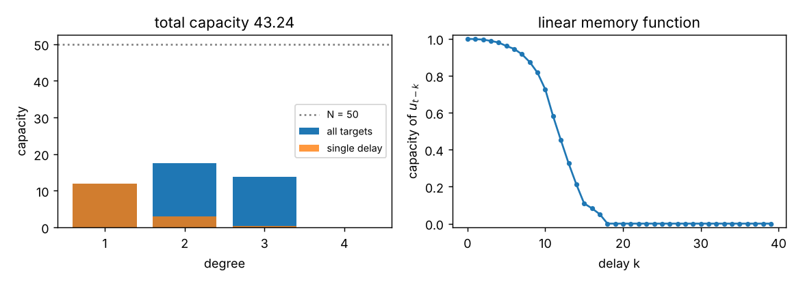

# MC_calc: information processing capacity of a reservoir

MC_calc computes the **nonlinear memory capacity** (information processing capacity, Dambre et al., *Sci. Rep.* 2, 514 (2012)) of a reservoir computer from its recorded states. A C++ program and a NumPy package are included; they implement the same algorithm and give the same numbers (tested).

## What is computed

The reservoir is driven by i.i.d. inputs $u_t$, uniform in $[-1, 1]$, and its states $x_t \in \mathbb{R}^N$ are recorded for $T$ steps. For each target built from normalised Legendre polynomials of delayed inputs,

$$
y_t = \prod_j P_{d_j}(u_{t-k_j}), \qquad k_1 < k_2 < \dots,\quad d_j \ge 1,
$$

the capacity is the fraction of the target's variance a linear ridge readout of the states can reproduce:

$$
C[y] = \frac{y^\top X\,(X^\top X + \lambda I)^{+}\,X^\top y}{y^\top y} \in [0, 1] \qquad (X,\ y \text{ centred over time}).
$$

Targets of different degree or delays are orthogonal, so their capacities add up to the total capacity, at most $N$. The degree of a target is $\sum_j d_j$:
- degree 1 targets $P_1(u_{t-k}) = u_{t-k}$ give the classic linear memory capacity
- degree 2 includes $u_{t-k}^2$ and products $u_{t-k}u_{t-l}$
- and so on

The program scans all delays $0 \le k < D$ (`-steps_for_memory`) and degrees up to $P$ (`-max_power_nonlinear_memory`).

**The finite-sample threshold.** For a target unrelated to the states, $C \approx \chi^2_N/T$. A capacity therefore only counts if it exceeds

$$\theta = F \cdot \chi^2_{N}\text{-quantile}(1-p)\,/\,T, \qquad F = 4,\ p = 10^{-5}\ \text{(defaults)}.$$

A scan over a delay stops after `-patience` (default 20) consecutive sub-threshold delays; `-patience 0` scans every delay.



*The example in `examples/esn_example.py`: a 50-node tanh ESN with bias, total capacity 43.2 of 50. Without a bias, a tanh reservoir is an odd function of its inputs and has no even-degree capacity at all, which makes a good sanity check.*

## C++ program

Requirements: [Armadillo](http://arma.sourceforge.net/) and [Boost](https://www.boost.org/) (headers only), e.g. `sudo apt install libarmadillo-dev libboost-dev`.

```bash
make                      # or: cmake -S . -B build && cmake --build build
./MC -h                   # all options
./MC                      # reads stateData and inputData from the current folder, writes memoryData
./MC -state_file states.txt -input_file inputs.txt -output_file capacities.txt -max_power_nonlinear_memory 4
```

**Input files** are plain text or any format Armadillo can load:
- `stateData`: one row per time step, one column per reservoir node
- `inputData`: one input per line, uniform in $[-1, 1]$

**Alignment:** state row $k$ belongs to input index $k$ + `start_target_row` (default 1000). So if you discard a washout of 1000 steps from the states but not from the inputs, the defaults fit. The input file needs at least (rows of `stateData`) + `start_target_row` values, and `start_target_row` must be at least `steps_for_memory` − 1. The program now checks both.

**Output** (`memoryData`) is a header plus one row per significant target, $4P+1$ columns:

| columns | content |
|---|---|
| `step1..stepP` | delays $k_j$ (0 = unused) |
| `degree1..degreeP` | Legendre orders $d_j$ (0 = unused) |
| `capacity` | $C[y]$ of this target |
| `total_deg1..total_degP` | running sum of capacities per total degree |
| `pure_deg1..pure_degP` | running sum for single-delay targets ($P_d(u_{t-k})$) per degree |

The last row therefore holds the totals, which are also printed at the end. Load it with `numpy.loadtxt("memoryData", skiprows=1)` or `pandas.read_csv("memoryData", sep=" ")`.

Options:

| flag | default | meaning |
|---|---|---|
| `-state_file`, `-input_file`, `-output_file` | `stateData`, `inputData`, `memoryData` | file names |
| `-start_target_row K` | 1000 | state row k belongs to input k + K |
| `-steps_for_memory D` | 50 | delays 0..D−1 |
| `-max_power_nonlinear_memory P` | 3 | highest total degree |
| `-regularisation_factor λ` | 1e-6 | ridge term |
| `-regularisation_factor_relative 0/1` | 0 | λ relative to max of $X^\top X$ |
| `-threshold C` | from χ² | fixed threshold instead of the χ² one |
| `-threshold_probability p`, `-threshold_factor F` | 1e-5, 4 | the χ² threshold above |
| `-do_without_threshold 0/1` | 0 | report every capacity |
| `-patience n` | 20 | early stop of a delay scan; 0 = full scan |
| `-precision n` | 6 | digits written |
| `-debug 0/1` | 0 | print settings and threshold |

## Python

```bash
pip install -e .            # numpy, scipy (matplotlib for plots)
```

```python
from mc_calc import information_processing_capacity

res = information_processing_capacity(states, inputs, max_degree=3, max_delay=50)
print(res.total_per_degree[1:], res.total)        # capacity per degree, total
res.linear_memory_function(50)                    # C[u_{t-k}] for k = 0..49
res.plot()                                        # the figure above
```

- **Aligned arrays:** by default, `states` and `inputs` have the same length with `inputs[t]` driving `states[t]`. The first `max_delay − 1` rows are then dropped so every delay is defined.
- **The C++ alignment:** pass `offset=K` to use the C++ convention instead.
- **Options:** all C++ options are keyword arguments (`ridge`, `ridge_relative`, `threshold`, `threshold_probability`, `threshold_factor`, `use_threshold`, `patience`).
- **Command line:** `python -m mc_calc states.npy inputs.npy --plot capacity.png` writes the same table as the C++ program.

## Tests

```bash
pip install -e ".[dev]" && make && pytest
```

Known answers:
- a delay line $x_t=(u_t,\dots,u_{t-9})$ has linear capacity exactly 10 and no nonlinear capacity
- adding $u_t^2$ and $u_t u_{t-3}$ adds exactly 2 in degree 2
- a bias-free tanh ESN has no even-degree capacity
- the total never exceeds $N$

The C++ program and the Python package produce the same significant targets and capacities, and bad input files give clear errors.

## Changes in 0.2

With default settings the capacities are identical to v0.1. That was checked on a delay line, a delay line with quadratic features, and a 50-node ESN; only the header line of `memoryData` changed.

- **Fixed:**
  - `-threshold` was overwritten by the χ² threshold and had no effect
  - an input file shorter than (state rows + `start_target_row`) was read past its end, silently giving wrong capacities with exit code 0; this is now an error that explains the alignment rule
  - `start_target_row` smaller than the largest delay indexed before the input; also an error now
  - a missing state file crashed inside Boost ("degrees of freedom is 0"); it now says which file could not be read
  - the README named the file `StateData`, but the program reads `stateData`
  - the output header (`STEP DEGREE CAPACITY`) did not match the 4P+1 columns
  - `-max_power_nonlinear_memory` above 14 overflowed fixed-size arrays
  - a flag given as the last argument read past `argv`, and unknown flags were ignored silently
- **New:**
  - `-state_file`, `-input_file`, `-output_file`, `-threshold_probability`, `-threshold_factor`, `-patience`, `-precision`, `-h`
  - totals printed at the end
  - the exact χ² quantile instead of a decimal search
  - Legendre values computed once per input
  - CMake
- **New:** the `mc_calc` Python package (API, CLI, plots), tests, CI and an example.
